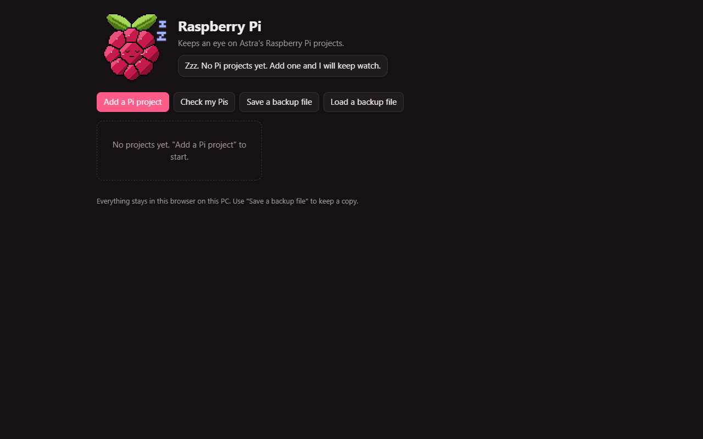

# Raspberry Berry

*A pet app by Astra.*

Raspberry Berry looks after Astra's Raspberry Pi projects. Its pet, Raspberry Pi, is drawn in the shape of the berry logo: two leaves on top and a berry of packed drupelets with black seams, with his face in the big middle one.

**Status: growing.** It works; the rough edges are listed under Limits.

## Pictures

Raspberry Berry's program page (`index.html`) on `main`, before any Pi project is added.

Screenshots taken 2026-10-17 with GitHub Goldfish's [project-image-generator](https://github.com/findastra/github-goldfish#project-image-generator); added with Claude Opus 5.5 (`claude-opus-5-5`), 2026-10-17.

## What it does

- Keeps a list of Pi projects: name, which Pi, status (idea, building, running, retired), hostname, user, OS, repo link, notes and GPIO pins.
- Shows the `ssh user@host` line for each Pi with a Copy button.
- "Backed up today" and "Updated today" buttons record the last SD card backup and OS update.
- "Save a backup file" and "Load a backup file" export and import the list as JSON.

## What his face means

| Mood | When |
|---|---|
| `sleep` | No projects yet. |
| `curious` | Checking the Pis. |
| `happy` | Just checked: every running Pi is backed up within 30 days and updated within 60. |
| `idle` | All good, nothing new. He blinks every few seconds. |
| `worried` | 1 to 5 things to fix (no backup, old backup, old OS update, no hostname). |
| `alarmed` | More than 5 things to fix. |
| `sick` | **He needs you:** the browser is blocking site storage, so he cannot remember the Pis. |
| `sad` | A backup file could not be read. |

Click him to check again.

## How to run it

Open `index.html` in any modern browser. There are no dependencies and no build step.

To redraw the pet after changing the art: `node scripts/draw-berry.mjs`. It writes `sprite.json`, `sprite.js` (the same frames, so the page works from disk), `logo.svg`, `art/frames/<mood>-20261010.png` (256 by 256) and `art/roster-20261010.png`.

## Limits

- No connection to the Pis themselves. It does not ping them, SSH in or read their real update state; the dates are what Astra records.
- Data lives only in the browser it was entered in. Use the backup file to move it or keep it safe.
- The pet is hand-drawn by `scripts/draw-berry.mjs`, not generated like the Cage's other pets, because the berry logo shape has to be exact. It uses the logo's own red and green rather than a neon palette. The stickers are copied from the Cage's shared set and drawn at 2x. Astra has not approved it yet.
- The older generated sheet (`art/sheets/raspberry-berry-20261009.png`) is kept for the record and no longer used.
- Not registered in the Cage yet. The job, status, moods and audit are submitted in `pet.json` for the Friendly Farmer in [astras-pet-os](https://github.com/findastra/astras-pet-os).
- No tests and no desktop version.

Desktop pet revision by OpenAI Codex (GPT-6), 2026-10-11. See desktop-pet-20261011.json for the current artwork, size and behavior. Desktop art remains a draft; no sparkles.
